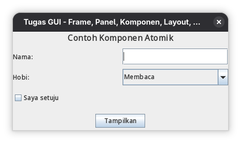
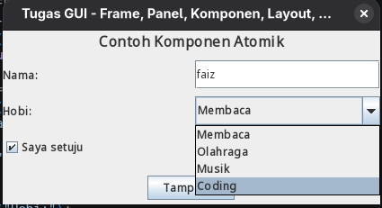
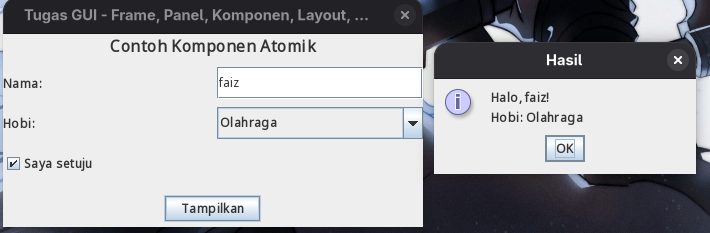
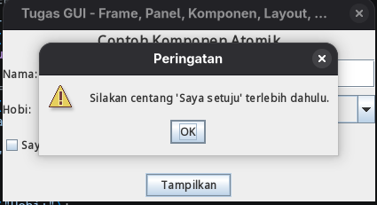
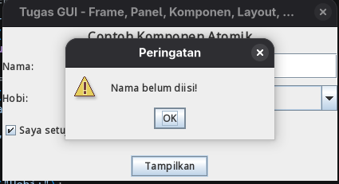

# Tugas GUI - Java Swing

Program GUI sederhana menggunakan **Java Swing** yang mendemonstrasikan kelima bagian GUI yang diminta: Top Level Container, Intermediate Container, Atomic Component, Layout, dan Event Listener.

## Struktur File

```
gui-assignment/
├── GUIApp.java              # Program GUI utama
├── README.md
└── screenshots/
    ├── 01-main.png
    ├── 02-combobox.png
    ├── 03-validation-name.png
    ├── 04-validation-agree.png
    └── 05-result.png
```

## Cara Menjalankan

```bash
cd gui-assignment
javac GUIApp.java
java GUIApp
```

> Butuh JDK (diuji dengan OpenJDK 25) dan sesi grafis/display untuk menampilkan jendela.

## Pemetaan 5 Bagian GUI

| Bagian | Implementasi di `GUIApp.java` | Screenshot |
|---|---|---|
| **1. Top Level Container** | `JFrame frame` — jendela utama |  |
| **2. Intermediate Container** | `JPanel formPanel` dan `JPanel buttonPanel` |  |
| **3. Atomic Component** | `JLabel`, `JTextField`, `JComboBox`, `JCheckBox`, `JButton` |  |
| **4. Layout** | `BorderLayout` (frame), `GridLayout` (form), `FlowLayout` (tombol) |  |
| **5. Event Listener** | `implements ActionListener` + `@Override actionPerformed(ActionEvent e)` |  |

### 1. Top Level Container - `JFrame`
`JFrame` adalah jendela utama yang berdiri sendiri di layar. Program diset `EXIT_ON_CLOSE` sehingga menutup jendela menghentikan program. UI dibangun di Event Dispatch Thread melalui `SwingUtilities.invokeLater`.

### 2. Intermediate Container - `JPanel`
Dua `JPanel` mengelompokkan komponen:
- `formPanel` — menampung label, input, combo box, dan checkbox (memakai `GridLayout`).
- `buttonPanel` — menampung tombol (memakai `FlowLayout`).

### 3. Atomic Component
Komponen yang langsung berinteraksi dengan pengguna:
- `JLabel` — teks judul dan label field.
- `JTextField` — input nama.
- `JComboBox` — pilihan hobi (dropdown).
- `JCheckBox` — persetujuan.
- `JButton` — tombol "Tampilkan".

### 4. Layout (3 layout class)
- `BorderLayout` — membagi frame menjadi NORTH (judul), CENTER (form), SOUTH (tombol).
- `GridLayout(3, 2, 8, 8)` — form 3 baris × 2 kolom.
- `FlowLayout` — menyusun tombol berjajar.

### 5. Event Listener
Class `GUIApp` meng-`implements` interface `ActionListener` dan meng-override method `actionPerformed`. Saat tombol "Tampilkan" diklik, listener membaca input lalu memvalidasi:
- Nama kosong → dialog peringatan.

  
- Checkbox belum dicentang → dialog peringatan.

  
- Input valid → dialog hasil.

  
